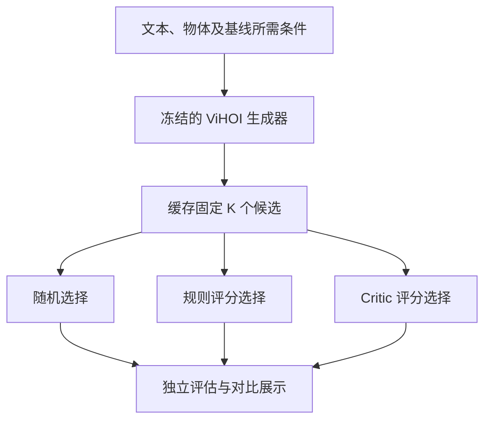

# CounterHOI

## 基于结构化错误交互监督的三维人–物交互生成与评估

**3D Human–Object Interaction Generation and Evaluation with Structured Invalid Interaction Supervision**

> 当前版本：FYP 实施方案。第一阶段聚焦 **Interaction Consistency Critic + Candidate Reranking**，完成生成、评分、筛选、评估与可视化闭环，并为后续生成器训练及论文实验保留接口。
>
> 本文描述目标方案，不代表代码、数据处理、训练或实验已经完成。ViHOI 暂定为基线，OMOMO 暂定为首个数据集；可用权重、数据、特征、许可证和运行条件需要实际核实。所有效果均为待验证假设。

---

## 1. 项目目标

三维人–物交互生成需要同时生成协调的人体动作与物体运动。某些结果虽然运动平滑，却存在交互错误，例如在需要持续抓持的搬运阶段，手提前离开物体，但物体仍继续按被搬运的轨迹运动。

本项目研究：

> 能否通过结构化错误交互样本训练一个轻量评分模型，使其识别真实生成结果中的交互错误，并从同一条件的多个候选中选择更合理的结果？

FYP 的目标不是从零开发生成骨干，而是在已有生成器基础上完成：

1. 可复现的三维交互生成与展示。
2. 一种可靠的错误交互构造方法及质量检查。
3. 一个交互一致性评分模型（Interaction Consistency Critic）。
4. 固定候选池上的自动筛选系统。
5. 独立评估、对照实验、失败分析和演示视频。

第一阶段改善的是 **候选选择**。除非后续完成生成器训练并有独立证据，否则不宣称生成器本身获得了改进。

## 2. FYP 范围与论文扩展边界

| 内容 | FYP 必做范围 | 后续论文扩展 |
| --- | --- | --- |
| 生成基线 | 跑通推理、评估和可视化；缓存候选 | 按公平数据协议训练或微调基线 |
| 错误样本 | 一种可靠的提前释放错误 | 更多空间、时序及动作相关错误 |
| 正样本检查 | 原始有效片段＋经验证的有效扰动 | 更丰富、难度匹配的正负轨迹对 |
| Critic | 轻量模型，验证合成与真实生成错误 | 泛化、迁移、结构和训练策略消融 |
| 输出改进 | 固定候选池重排序 | 可微一致性目标优化生成器 |
| 对照实验 | 随机选择、规则选择、Critic 选择 | 直接接触损失、随机负例、课程训练等 |
| 泛化 | 独立原始序列测试；审计组合覆盖 | 严格的 Seen / Unseen Pair 实验 |
| 数据集 | 一个数据集 | 按需要增加第二数据集 |
| 交付 | 代码、配置、结果、Demo、FYP 报告 | 完整实验与投稿论文 |

FYP 不强制完成生成器重训练、完整组合泛化、难度课程、新骨干、多物体交互、关节物体、物理仿真控制或真实机器人部署。

FYP 完成标准是系统闭环、实验可信、结果分析完整。研究效果不预设为正；即使 Critic 未超过规则，也应报告结果和适用边界。论文扩展取决于是否获得有意义、可重复的收益。

## 3. 整体流程

### 3.1 Critic 训练

从训练集有效交互片段中构造两类样本：保留交互关系的正样本，以及经有效性筛选的错误负样本。提取一致的运动与几何特征后，训练轻量时序评分器。

### 3.2 生成与候选筛选



候选数量 `K` 可配置，初版可用 `K=4` 进行小规模验证；它是初始设置，不是已证明的最佳数量。三种方法必须共享相同候选 ID、条件和候选池。

ViHOI 的实际输入可能包含额外条件和视觉特征，不能直接假定为纯文本加物体。首先核实官方接口，再统一封装。生成一次后缓存运动、特征和元数据，评分器变化时无需重新生成候选。

## 4. 数据与划分

### 4.1 数据审计

优先使用 OMOMO 及基线兼容的处理后数据，确认：

- 原始序列 ID、人物 ID、动作文本、物体 ID 与类别。
- 人体表示、关节顺序、物体位姿、几何与坐标约定。
- 距离单位、帧率、有效帧掩码和运动片段长度。
- 接触标签来源，以及是否存在可用于判断持续抓持阶段的信息。
- 可用基线检查点、VLM 特征、评估器及其训练数据范围。

先按原始序列冻结 train / validation / test，再切窗口与构造扰动。一个原始序列及其所有衍生样本必须留在同一个集合中。阈值与超参数只用 train / validation 确定。

FYP 可优先沿用核实后的官方划分，并披露基线与 Critic 的数据暴露情况。自定义未见组合划分如果与预训练权重冲突，不能直接声称严格组合泛化。

### 4.2 独立真实生成评估集

真实生成结果是核心测试对象。建立开发/验证候选集与最终测试候选集，用前者调规则阈值、选择模型，用后者报告最终结果。

人工检查记录“合理 / 错误 / 不确定”、错误类型及理由。检查时隐藏选择方法与 Critic 分数。不确定案例单独报告，不强行转成确定标签。尽可能安排两名成员独立检查一个子集，再记录分歧和复核结果。

## 5. 结构化错误交互构造

### 5.1 第一种错误：Premature Release

只对需要持续抓持或支撑的交互阶段进行扰动：在片段中提前打断必要的人–物接触，同时保留相应物体搬运运动，构造“动作局部平滑、交互关系被破坏”的负例。

具体修改姿态、相对位置或时序的方式由数据表示决定。必须修改实际运动并重新计算接触，不允许只把接触标签从 1 改成 0。

排除合法投掷、惯性运动、自由落体、正常释放、其他身体部位持续支撑，以及环境支撑足以解释运动的情况。仅凭“距离大于阈值且物体在动”不足以确定负例。

### 5.2 有效性筛选

每个负样本检查：运动连续性、异常速度/加速度、接触中断、物体支撑条件和动作阶段。对不同扰动强度分层抽查，区分：

- 有效负例：交互确实被破坏，且不存在主导分类的明显动画痕迹。
- 无效负例：交互仍然合理，或出现严重拼接等非目标错误。
- 不确定：缺少足够信息判断，排除出确定监督。

记录候选数、接受数、排除原因及人工抽查比例。样本筛选规则与最终独立评价需要区分，避免只证明模型复现了构造规则。

### 5.3 有效扰动正例

增加少量“修改过但仍然有效”的轨迹作为正样本或专项测试，检查 Critic 是否把修改痕迹误判为错误。

低成本起点是对完整人–物系统做一致的水平平移或绕竖直轴旋转；必须同步变换物体、人体及相关空间条件，并确认环境或文本条件没有被破坏。这类检查只证明对相应变换的稳健性，不能单独证明模型完全不依赖局部扰动痕迹。

### 5.4 元数据

保存 `source_id`、`split`、`label`、`corruption_type`、`severity`、`seed`、适用阶段、扰动参数、筛选结论与理由。明确区分“负例构造有效”与“交互本身有效”，避免模糊的 `validity=true`。

## 6. Interaction Consistency Critic

初版使用一个轻量时序模型，例如 TCN 或小型 Transformer，暂不并行开发多种复杂架构。

输入优先包含人体关节运动、物体位姿/速度、人–物相对几何与接触距离。若数据提供可靠文本/动作特征，可使用冻结编码或已有缓存；不重新训练语言模型。

输出为序列级一致性 logit；越大表示模型认为越合理。未经校准的分数不解释为“真实物理正确概率”。

```text
L_critic = BCEWithLogitsLoss(logit, label)

label = 1：经检查的有效交互
label = 0：经检查的错误交互
```

第一版先完成二分类。排序损失、分错误类型输出和课程训练留作扩展。记录正负比例、随机种子、训练步数和验证集模型选择方式。

必须分别评估：独立序列合成负例、有效扰动正例，以及真实生成错误。合成分类准确率高不等于真实交互评分有效。

## 7. 候选选择与公平对照

| 方法 | 选择方式 | 作用 |
| --- | --- | --- |
| Random Selection | 固定随机种子，从同一 K 个候选中选择一个 | 无评分选择的基础对照 |
| Rule-based Selection | 按独立接触/相对几何规则评分 | 检查简单规则是否足够 |
| Critic Selection | 选择 Critic 分数最高的候选 | 检查学习式评分的收益 |

规则基线由 C 负责，依据可获得的信息设计，阈值只在验证集确定。规则不得使用推理时不可获得的真实接触时间或测试答案。所有方法共享候选池、条件与可用信息，并报告评分额外耗时。

随机选择可用多个固定种子统计波动，或计算每个候选池的均匀选择期望；这些操作复用已有候选，不额外生成运动。若所有候选都错误，重排序可能无法给出正确结果，应单独分析候选覆盖不足。

## 8. 独立评估与成功标准

### 8.1 核心指标

| 维度 | FYP 评估内容 | 说明 |
| --- | --- | --- |
| Critic 判别 | AUROC、Balanced Accuracy、混淆矩阵 | 报告合成与真实生成数据各自样本量；单类子集不计算 AUROC |
| 选择质量 | 选中结果的人工交互合理率、提前释放错误率 | 方法匿名，提前固定判定标准及不确定样本处理 |
| 几何与接触 | 核实后采用独立几何指标 | 排除合法无接触运动，报告阈值与单位 |
| 生成整体质量 | 可运行且适用的基线官方指标、文本符合度与运动质量检查 | 不以持续抓住或动作僵硬换取表面接触提升 |
| 效率 | 候选生成与评分分别计时、显存峰值 | 缓存阶段与在线阶段分开报告 |

参考接触可对齐且评价含义成立时才报告 Contact Precision / Recall / F1；几何阈值推导的标签称为接触估计或伪标签。不能用 Critic 自己的分数证明 Critic 选择更好。

保存逐条件结果，报告真实样本数量与不确定性；重采样统计按独立条件或原始序列分组，不能把同一序列的相邻帧当作独立样本。

### 8.2 FYP 验收

- [ ] 基线可生成、保存、加载和展示三维人–物运动。
- [ ] 数据划分及衍生样本不存在跨集合泄漏。
- [ ] 一种可靠负样本构造与有效扰动检查完成，并有人工抽查记录。
- [ ] Critic 可训练、验证、保存、加载和批量评分。
- [ ] 三种选择方法在同一候选池上运行。
- [ ] 使用独立评估检查真实生成结果，报告所有核心对照。
- [ ] 提供成功、失败、无改善及候选全部失败的案例分析。
- [ ] 提供运行说明、配置、实验记录、对比视频和 FYP 报告。

完成上述项目意味着实现了可评估的 FYP 系统，不保证研究假设成立。若 Critic 在真实生成结果中稳定优于规则，才进一步考虑扩大论文实验。

## 9. 三人职责与交付物

### A：Baseline & System Integration — 基线与系统集成

**负责把生成、评分、选择与展示连接成可运行系统。**

工作内容：

- 核实基线来源、版本、许可证、检查点、数据与特征依赖，完成推理复现。
- 明确生成器输入输出、坐标系、关节表示及额外条件，封装统一适配器。
- 测试显存与生成速度，固定采样配置和随机种子，生成并缓存候选池。
- 实现随机选择、统一评分器调用、Critic 重排序与结果导出。
- 集成 C 的评估与可视化入口，提供命令行演示和并列对比视频；网页界面可选。
- 记录系统限制与运行步骤，撰写基线和系统实现章节。

交付：生成器适配器、候选缓存、选择入口、演示脚本、配置、复现记录与运行文档。

**边界：** FYP 阶段不要求 A 训练生成器；不承担 Critic 模型训练或规则评分器设计。

### B：Counterfactual & Critic — 错误样本与评分模型

**负责构造可信监督并训练交互评分模型。**

工作内容：

- 审计人体、物体与接触数据，和 A/C 共同冻结运动数据接口。
- 实现训练侧接触/相对几何特征、提前释放扰动和负样本有效性筛选。
- 实现有效扰动正例或专项测试，保存完整扰动参数与来源。
- 在固定划分内生成数据，组织分层抽查并记录不确定样本。
- 实现轻量 Critic、训练配置、检查点加载与统一评分接口。
- 先用一种可靠扰动交付可用 Critic v0，不等待更多类型完成。
- 配合 C 检查合成错误到真实生成错误的迁移，分析模型依赖的线索。
- 撰写样本构造、Critic 方法与相关实验章节。

交付：样本构造工具、元数据与质量报告、特征提取器、Critic、配置、检查点及训练记录。

**边界：** B 的构造规则不直接充当最终真值；最终规则对照和评价协议由 C 负责。

### C：Evaluation & Research — 划分、独立评估与实验管理

**负责实验是否公平、结论是否可信。**

工作内容：

- 在正式数据生成与 Critic 训练前冻结 train / validation / test，检查序列泄漏及基线预训练暴露。
- 统计动作–物体覆盖，为后续组合泛化提供可行性报告；FYP 不强造稀疏组合测试。
- 跑通适用的官方评估，实现独立规则评分器及交互指标。
- 固定真实候选开发集和测试集、匿名抽查协议、阈值选择与统计方法。
- 比较随机、规则、Critic 选择，维护统一结果表并记录失败与无收益结果。
- 负责评估可视化、图表及 Demo 中的接触标注展示，A 负责最终系统集成。
- 维护相关工作与差异记录，撰写实验设置、结果分析与研究限制章节。

交付：划分清单、规则评分器、评估代码、人工检查记录、统计表、图表和相关工作记录。

**边界：** C 不独自承担全部论文写作；三人各写负责模块，共同审核摘要、结论与答辩材料。

### 协作依赖

1. A 提供少量真实生成样本，B/C 据此验证表示与评估可行性。
2. C 冻结划分，三人共同确认数据契约后，B 才构造正式训练数据。
3. B 交付 Critic v0 和评分接口，A 完成重排序集成。
4. C 在冻结测试集上独立评估，三人共同分析结果。

分支建议：A 使用 `baseline-system`，B 使用 `counterfactual-critic`，C 使用 `evaluation-protocol`。小任务通过 PR 合并，每项交付附运行命令、实际结果和已知问题。

## 10. 统一接口：为论文扩展预留

以下是拟定接口契约，不表示当前仓库已实现这些 API。先固定数据格式与边界，不预先实现尚未需要的大模块。

### 10.1 MotionSample 与数据契约

每条样本包含 `schema_version`、`source_id`、`sample_id`、`split`、`condition`、`human_motion`、`object_motion`、`valid_mask` 与 `metadata`。

人体表示、张量形状、关节顺序、物体局部坐标、旋转表示、帧率、单位及归一化参数放在版本化配置中。`condition` 同时记录文本、物体几何和基线实际需要的其他条件，避免不同方法信息不对等。

基础元数据保持动作标签、物体类别/实例、人物 ID 和原始序列来源可追溯，为后续重新划分和泛化实验提供支持。

### 10.2 生成、扰动、评分与选择

```python
# 生成器适配器：保留替换骨干的可能
candidates = generator.generate(condition, num_candidates=K, seeds=seeds)

# 扰动插件：新增类型时无需改写数据加载器
result = corruption.apply(sample, severity=severity, seed=seed)
# result: modified_sample, target_label, applicability, audit_metadata

# 固定候选评分；规则与 Critic 使用相同的“越大越好”约定
scores = scorer.score(candidates, condition)  # shape [K]
selected_id = selector.select(candidate_ids, scores)

# 独立评价：不将训练 Critic 分数作为质量真值
metrics = evaluator.evaluate(selected_samples, annotations, protocol)
```

候选缓存记录 `condition_id`、`candidate_id`、`generator_commit`、`checkpoint_id`、`sampling_config` 和 `seed`；选择结果单独保存，不能覆盖原始候选。

### 10.3 可微评分扩展

将神经网络 `forward()` 与用于 FYP 推理的 `score()` 分开：`score()` 可以关闭梯度、批处理缓存；`forward()` 保持张量运算与梯度路径，便于后续一致性训练。

未来训练生成器时，即使冻结 Critic 参数，也必须允许梯度传回生成运动。FYP 使用的硬接触阈值、离线网格处理或 NumPy 特征不自动具有可微性，接入训练前必须新增或替换相应特征路径并测试。

### 10.4 评估与配置扩展

使用独立配置管理 `generator`、`corruption`、`features`、`critic`、`selector`、`split`、`evaluation`。固定协议与结果表结构，可增加 `seen_pair / unseen_pair` 分组和不同训练方法，不改写已有 FYP 评价。

## 11. 建议目录结构

以下为规划结构；缺少代码时不要将文件名视为现成运行命令。

```text
3DHOI/
├── README.md
├── configs/                 # 表示、数据、模型、候选生成与评价配置
├── adapters/                # ViHOI 适配器及统一运动格式
├── datasets/                # 加载器、数据审计、划分检查
├── features/                # 共享几何原语、训练侧特征
├── counterfactual/          # 扰动插件、有效性筛选、正例检查
├── models/                  # Interaction Consistency Critic
├── training/                # FYP: Critic 训练；后续可加生成器训练
├── selection/               # Random / Rule / Critic 选择
├── evaluation/              # 独立指标、统计与人工检查汇总
├── visualization/           # 渲染、接触时间线与视频
├── scripts/                 # 审计、生成、训练、筛选、评估入口
├── splits/                  # 版本化划分清单
├── tests/                   # 数据泄漏、坐标、掩码等关键检查
└── reports/                 # 复现、数据质量、实验与失败分析
```

原始数据、大型特征、运动缓存、检查点与视频存放在可配置的数据目录，默认不纳入 Git。共享几何基础函数可以复用，但训练标签、样本筛选与最终判定逻辑保持边界清楚。

## 12. 资源与复现要求

FYP 只训练轻量 Critic，生成器冻结。优先使用现有 16GB GPU 做开发与小批量推理；是否适配目标 ViHOI 配置，以实际显存测试为准。显存不足时再使用 24GB 或更大显存 GPU，不预先承诺完整配置可运行。

采用缓存特征、分批生成、复用固定候选池减少重复开销。参考图像与 VLM 特征的来源需记录；测试时不能使用目标真实运动渲染图替代正式推理条件，除非单独标为使用额外真实信息的诊断实验。

训练与生成耗时均通过短测试确定，分别记录预处理、生成、Critic 训练、评分及渲染时间。若基线检查点或处理后数据不可获取，应先解决资源问题，不能把“只训练小 Critic”的预算套用于从头训练生成器。

每次实验记录 Git commit、数据及划分版本、随机种子、配置、GPU、峰值显存、运行时间、检查点、候选池 ID、指标与评价命令。只写实际运行结果，不编造安装命令、完成状态或性能数字。

## 13. 后续论文扩展路线

扩展以 FYP 真实结果为依据，不要求一次完成所有方向。

| 扩展方向 | 复用 FYP 资产 | 新增工作 | 应回答的问题 |
| --- | --- | --- | --- |
| 更多结构化负例 | 扰动接口、元数据、质量检查 | 时序错位、空间接触偏移等可靠类型 | 错误设计是否比通用随机扰动有效？ |
| 生成器一致性训练 | Critic、生成器适配器 | 可微特征、冻结 Critic 的训练损失 | 能否改善生成器本身？ |
| 直接几何约束对照 | 相对几何与评估代码 | 接触/相对几何损失，匹配训练预算 | 为什么需要学习式 Critic？ |
| 组合泛化 | 来源信息、动作物体统计、划分工具 | 严格未见组合划分及必要的基线重训 | 收益能否迁移到新组合？ |
| 难度课程 | severity 与负样本缓存 | 同池随机混合与课程采样 | 收益是否来自课程而非额外训练量？ |
| 更充分验证 | 统一生成和评估接口 | 多种子、第二骨干或第二数据集 | 结论是否稳定且可迁移？ |

候选生成器目标可写为：

```text
L_total = L_baseline + λ · L_consistency
```

该目标仅为未来接口方向，具体预测参数化、梯度路径、几何解码和训练稳定性需要单独验证。FYP 的重排序成功不自动意味着此训练目标有效。

组合泛化是实验问题，不直接视为独立原创贡献。难度课程保持选做；若无收益，应如实报告，不为凑贡献数量强行保留。

## 14. 研究定位与参考入口

本项目将“反事实负例”限定为受控构造的错误轨迹，不主张严格因果识别，也不把所有替代动作都视为无效。不能宣称首次在 HOI 中使用 counterfactual learning，或仅凭多个模块的组合就认定新颖性。

核心待验证主张是：**针对性的错误交互监督能否学到超越简单接触规则的评分能力，并改善真实三维交互候选的选择。** 论文扩展进一步研究其对生成训练和组合泛化的作用。

参考入口（已有公开来源，实施时继续核实当前代码、权重与许可证状态）：

- [ViHOI 官方仓库](https://github.com/MPI-Lab/ViHOI)：首选基线与运行接口来源。
- [ViHOI 论文](https://arxiv.org/abs/2603.24383)：视觉先验与 HOI 生成设置。
- [ScriptHOI](https://arxiv.org/abs/2605.05057)：HOI detection 中的反事实脚本监督；提醒避免宽泛的首次性声明。
- [PRISM](https://arxiv.org/abs/2609.38172)：通过反事实视频扩充交互数据并用于机器人学习；与本项目的无效轨迹负例用途不同。
- [COSMI](https://arxiv.org/abs/2610.03252)：多物体组合生成与未见交互组合；组合泛化不作为本项目独占概念。
- [DIGHT](https://arxiv.org/abs/2610.10322)：物理偏好驱动的交互生成后训练；作为学习策略相关工作讨论。

相关工作用于界定问题与设计对照，不要求 FYP 复现所有方法。跨任务论文不能直接当作数值基线；后续是否投稿，由结果、相关工作核查与导师意见共同决定。

## 15. 最终交付

提交可运行源码、配置与数据准备说明、版本化划分、样本质量报告、Critic 检查点（许可允许时）、固定候选池索引、三种选择方法结果、独立评估记录、对比视频和 FYP 报告。

Demo 展示同一条件和候选池下的随机、规则与 Critic 选择，叠加接触点或时间线，包含成功、失败与无改善案例。完整系统应能从保存的候选缓存重现选择与评价，无需为每次演示重新生成全部运动。
