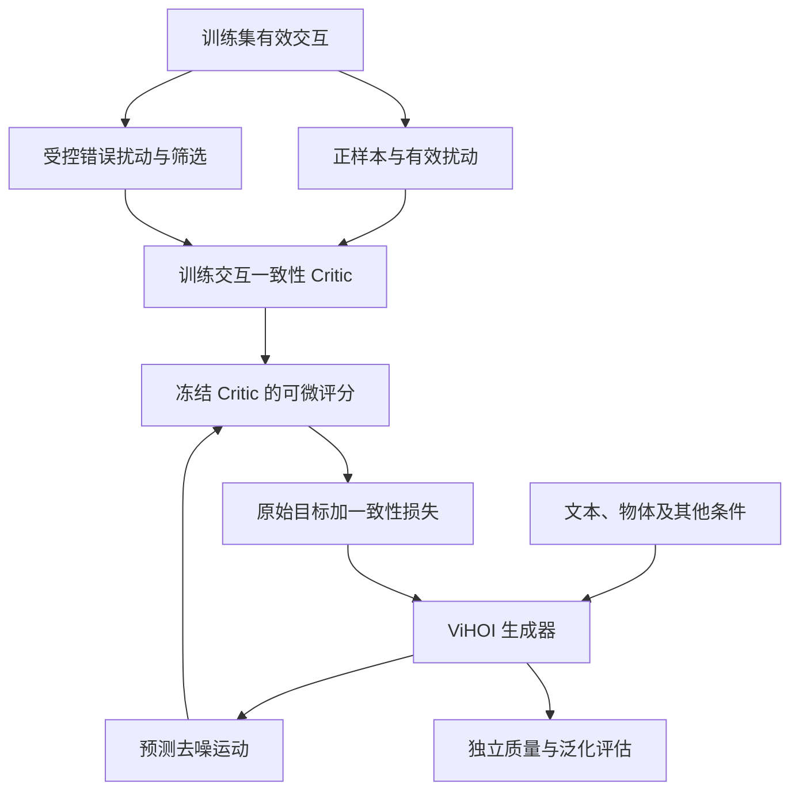

# CounterHOI

## 基于结构化错误轨迹监督的三维人–物交互生成

**Learning 3D Human–Object Interaction Generation from Structured Invalid Trajectories**

通过构造具有明确交互错误的三维运动轨迹，训练交互一致性评分模型（Interaction Consistency Critic），并将其接入已有生成器，研究能否改善生成质量、交互一致性与未见动作–物体组合上的表现。

> **项目定位：完整研究方案，用于 FYP，并为后续论文投稿积累实验。** 主路线为“结构化负样本 → Critic → 生成器一致性训练 → 独立评估”；候选重排序是先验验证及备用方案，不替代主路线。Difficulty-Aware Curriculum 为辅助实验。
>
> **当前进展说明：** 团队已报告取得 ViHOI 权重，并已推进原分工中的 A、B 工作。本文不将其具体代码、训练结果或集成状态自动标记为完成；后续以现有提交、配置、检查点与运行日志登记进度。已完成且验证有效的模块继续复用，不要求重新开发。

---

## 1. 项目目标

三维人–物交互（3D HOI）生成需要协调人体动作、物体运动和接触关系。生成结果可能局部平滑，却出现持续抓持阶段提前松手、必要接触缺失、接触与物体运动时序不一致等错误。

本项目研究：

> **在相同训练数据和生成骨干下，针对性的错误交互监督，能否比简单接触约束或通用随机扰动更有效地改善真实生成结果，并迁移到未见动作–物体组合？**

项目输入为文本、物体表示及基线实际需要的其他条件，输出为人体与物体的三维运动序列。额外的视觉先验、初始状态和轨迹条件必须依据实际 ViHOI 接口记录，不能将任务未经核实地描述为纯文本生成。

FYP 交付完整系统、可复现实验、演示和研究报告；论文是否具备投稿竞争力，由方法差异、实验收益、可靠性和相关工作核查决定，不预设结果或录用承诺。

## 2. 研究范围

| 项目 | 本项目安排 |
| --- | --- |
| 主基线 | ViHOI；复用已取得的检查点并核实版本、适配数据及使用条件 |
| 首个数据集 | OMOMO / 基线兼容的处理后数据，实际格式与标注需审计 |
| 核心模块 | 结构化负样本、Interaction Consistency Critic、生成器一致性训练 |
| 核心实验 | 真实生成错误、直接几何约束对照、负样本设计、组合泛化 |
| 辅助实验 | Difficulty-Aware Curriculum、候选重排序及候选数分析 |
| 可选扩展 | 第二数据集、第二生成骨干、更多未见物体 |
| 暂不纳入 | 新扩散骨干、VLM 重训练、多物体与关节物体、机器人部署、完整物理仿真控制 |

接触表示用于构造监督、提取特征和评价，不单独包装为主要创新。组合泛化是核心研究问题与评价设置，不因使用 unseen split 就自动构成独立创新。

## 3. 总体技术路线



先验证 Critic 是否能识别真实生成错误，再接入生成器训练；该顺序用于降低集成风险，不缩减最终研究范围。重排序实验复用已有候选，帮助判断评分器是否有用，但其收益不等于生成器学习收益。

## 4. Counterfactual Negative Interaction Generation

### 4.1 定义与构造原则

本文的“反事实负例”指受控修改运动后产生的错误交互，不主张严格因果识别。尽量只破坏目标交互因素，同时保留局部运动合理性、动作条件及其他关系。

必须修改真实姿态、位置或时序，再重新计算几何与接触。不能只篡改接触标签，或依靠严重跳变让模型轻易分类。

### 4.2 负样本类型

| 类型 | 构造思路 | 适用条件与边界 |
| --- | --- | --- |
| Premature Release | 在需要持续抓持的阶段提前打断接触，保留对应物体搬运运动 | 排除正常释放、投掷和允许接触中断的动作 |
| Object Motion Without Required Contact | 改变人–物相对位置或时序，使物体缺失必要支撑时仍按受控轨迹运动 | 排除惯性、滚动、自由落体、其他身体部位或环境支撑 |
| Spatial Contact Shift | 改变交互位置，破坏特定动作要求的接触关系 | 非原始抓持位置不一定错误，必须有几何或语义依据 |
| Wrong Body Part | 将接触转移到与当前任务不相容的身体部位 | 语义依赖强，作为有条件扩展；非手部接触本身不等于错误 |

优先复用团队已经完成且通过检查的类型。不能为了凑满类别，加入无法可靠判断的负例；前两种时序/支撑错误也可能重叠，应记录适用阶段与错误定义，避免当作独立贡献重复计数。

### 4.3 有效性筛选与人工检查

检查运动连续性、异常速度/加速度、距离、穿透、接触阶段和支撑状态。负例按“构造有效 / 构造无效 / 不确定”登记，不确定样本不进入确定监督。

分层抽查不同动作、对象、扰动类型和强度，记录接受率及排除原因。需要区分标签：`interaction_label` 表示交互是否有效，`construction_status` 表示构造是否通过检查，避免模糊的 `validity=true`。

每条衍生样本保留原始序列 ID、划分、扰动类型、参数、强度、随机种子、阶段、标签依据和检查结论。

### 4.4 有效扰动检查

增加“修改过但仍然有效”的正例或专项测试，避免 Critic 将编辑痕迹当成错误依据。可从同时变换人体、物体与相关条件的水平平移或竖直轴旋转开始；必须保持环境和文本约束成立。

这类全局变换只检验对应不变性，不能单独排除所有局部扰动捷径。后续可加入经人工确认仍有效的局部小幅变化，使正负样本在扰动幅度和运动平滑性上更接近。

## 5. Interaction Consistency Critic

### 5.1 输入、模型与输出

输入包含人体运动、物体运动、人–物相对几何、接触距离及可靠的文本/动作条件。优先采用已有冻结文本特征，不训练新的语言模型。

初版使用轻量时序编码器，如 TCN 或小型 Transformer，再接评分头。统一输出序列级 logit，分数越大表示模型认为交互越一致；未经校准不解释为真实物理正确概率。

### 5.2 训练目标

```text
L_critic = BCEWithLogitsLoss(C(x, condition), y)

y = 1：经检查的有效交互
y = 0：经检查的错误交互
```

先使用二分类目标；如果同源正负轨迹对可靠，可将排序损失作为后续消融，不与所有其他变化同时加入。

数据加载不向模型输入扰动类型、标签理由等会泄漏答案的元数据。正负样本采用一致的长度掩码、预处理和数据格式，防止 padding、来源或编码差异成为捷径。

### 5.3 必须验证的能力

- 独立原始序列上的有效/错误交互区分。
- 对未见扰动强度、可行时未见类型的迁移。
- 有效扰动正例上的稳健性。
- 最重要：由实际生成器产生的正确与错误交互。
- 与简单距离、接触和相对运动规则的比较。

若只在合成负例上表现好，对真实生成错误无效，应优先调整样本构造与表示，而不是直接扩大网络。

## 6. 主路线：Critic 接入生成器训练

先训练 Critic，再冻结其参数，将生成器预测的去噪运动解码到一致表示，用可微特征计算评分并优化生成器。

```text
L_total = L_baseline + λ · L_consistency

L_consistency = softplus(-C(predicted_clean_motion, condition))
```

这是候选目标，具体实现必须适配 ViHOI 的预测参数化，不能把扩散噪声预测直接当作真实运动。训练步数、λ、作用时间步范围等通过验证集确定。

集成验收：

1. Critic 权重冻结，但梯度可经过 Critic 和特征计算返回生成器。
2. 不在训练路径中误用 `no_grad()`、`detach()` 或不可微的离线特征。
3. 几何项采用可微距离等形式；硬接触阈值可以用于评价，但不能截断关键训练梯度。
4. 损失与梯度有限，坐标、尺度、掩码和运动解码正确。
5. 保留原始生成目标，并检查动作质量、文本符合度和多样性。
6. 最终效果使用独立指标和匿名检查验证，不以 Critic 分数上升作为成功证据。

冻结 Critic 仍可能被生成器利用评分漏洞，应检查异常静止、持续抓持、动作偏移等结果。必要时降低权重、限制适用阶段或改进评分器；修改后须重新冻结配置并评价。

## 7. 辅助与备用路线：候选重排序

在相同条件下生成固定 `K` 个候选，缓存后分别进行随机、规则和 Critic 选择。三种方法共享候选 ID、输入信息和生成预算，报告额外评分耗时。

候选数量可配置。随机选择使用固定种子或计算均匀选择期望；不同评分器复用同一候选池，无需重复生成。若全部候选均错误，重排序不保证产生正确结果，应分析候选覆盖情况。

重排序用于先验证 Critic 的实用性，也是生成器训练不稳定时可保留的完整交付。但若最终只有重排序结果，必须将结论限定为候选选择改善，并明确主训练路线的实际状态。

## 8. 数据划分与组合泛化

### 8.1 固定数据协议

在正式训练前冻结 train / validation / test。先按原始序列划分，再切窗口、生成扰动；同源窗口和衍生样本不能跨集合。

归一化统计量只使用训练集。规则阈值、负例强度、模型选择和课程参数只用训练/验证集确定。真实生成结果也分开发验证候选集与最终测试候选集，测试结果不反复用于改模型。

### 8.2 Unseen Action–Object Pair

合法未见组合满足：动作和物体类别分别在训练集中出现，但二者组合不出现。先统计真实动作–物体频次矩阵，再选择有足够样本支持的划分。

区分未见组合、未见物体实例和未见物体类别，不能混用术语。数据不足时缩小结论或增加数据，不制造无法支撑统计的测试集。

### 8.3 已有权重的数据暴露

取得 ViHOI 权重可以节省获取可用模型的成本，但不自动满足自定义组合划分。必须记录权重来源、训练数据范围、配置与校验信息。

若预训练权重已经见过保留组合，则不能将其称为严格未见组合实验。选择重新按划分训练公平基线，或明确改为“已知预训练暴露条件下的泛化分析”，并披露限制。所有方法使用相同的数据暴露与条件。

## 9. Difficulty-Aware Curriculum

课程训练作为辅助实验，不预设其优于随机混合。难度结合扰动幅度、持续时间与实际验证表现定义，不直接把物理、空间、时间类型固定等同于简单、中等、困难。

比较同一负样本池的 Random Mixing 与 Difficulty Curriculum，匹配训练步数、正负比例并尽可能匹配样本总曝光量。参数由验证集确定，不能以测试集表现动态调整课程。

若课程无收益，报告结果并保留基础方法，不强行将其作为贡献。

## 10. 实验与独立评价

### 10.1 核心实验矩阵

| 实验 | 对照设置 | 回答的问题 |
| --- | --- | --- |
| 原始基线 | 原始 ViHOI 检查点 | 原始性能参考 |
| 训练预算对照 | 基线继续训练相同步数，仅保留原目标 | 收益是否只是来自额外训练？ |
| 直接约束 | 同骨干加入直接接触/相对几何损失 | 为什么需要学习式 Critic？ |
| 完整方法 | 同骨干加入结构化负例训练的 Critic 目标 | 是否改善真实生成质量？ |
| 负样本设计 | 通用随机扰动 vs 结构化交互扰动 | 特定错误构造是否有价值？ |
| 重排序 | 同候选池随机、规则、Critic 选择 | 评分能力是否可用于候选选择？ |
| Critic 迁移 | 合成错误 vs 真实生成错误 | 是否学到了超越扰动痕迹的规律？ |
| 组合泛化 | Seen / Unseen Pair 分组比较 | 收益能否迁移到未见组合？ |
| 类型与课程 | 逐类移除；随机混合 vs 课程 | 哪些监督和训练策略有效？ |

核心训练对照匹配数据、初始化、训练预算、模型选择规则与采样配置。更多骨干或第二数据集属于后续扩展，不能挤占关键对照。重要结果尽量重复随机种子，报告实际数量与波动，单次结果明确标记。

### 10.2 指标与人工检查

| 维度 | 指标/检查 | 使用限制 |
| --- | --- | --- |
| 生成质量 | 核实后沿用适用的官方指标 | 相同预处理与评估器，检查其数据暴露 |
| 接触质量 | Contact Precision / Recall / F1 | 仅用于参考可对齐且定义成立的设置，不将唯一参考接触当作唯一正确答案 |
| 交互错误 | 提前释放率、必要接触中断率、缺乏支撑的运动比例 | 定义阶段、分母和合法例外 |
| Critic | AUROC、Balanced Accuracy、混淆矩阵 | 合成与真实数据分别统计，单类子集不计算 AUROC |
| 语义与运动 | 文本符合度、运动平滑性、多样性及失败案例 | 防止靠僵硬或持续抓持刷高接触指标 |
| 效率 | 训练/生成/评分耗时、峰值显存 | 缓存与在线计算分开记录 |

几何推导接触称为估计或伪标签。记录阈值、单位、坐标与帧率，并做必要敏感性检查。

真实结果人工评价隐藏方法名称和 Critic 分数，记录合理、错误和不确定及判定理由；安排两名成员复核一个子集，报告分歧处理。统计单位为独立条件或原始序列，不把相邻帧当独立样本。

## 11. 三人工作分配

分工对应职责和最终交付，不按周排期。各负责人先盘点已有代码、配置与日志，复用已完成部分，只补缺项。规则基线仅由 C 负责，避免与 B 重复实现。

### A — Generation & Integration Lead：生成器与集成负责人

**核心职责：让 Critic 真正影响生成，并完成公平的生成器实验。**

工作内容：

- 接收并核实已有 ViHOI 权重、代码版本、配置、数据依赖和推理结果。
- 整理生成器输入输出、条件、预测参数化和训练入口，封装统一适配器。
- 生成与缓存真实候选，提供固定采样配置及候选索引给 B/C。
- 实现 Critic 可微一致性目标、冻结参数和梯度连通检查。
- 负责原始基线、等预算继续训练、直接几何约束、完整方法等生成器训练对照。
- 实现候选重排序调用与模型结果导出，作为先验检查和备用交付。
- 记录显存、速度、检查点和失败状态；集成 C 的评价与可视化形成 Demo。
- 撰写基线、生成器集成、训练设置和系统实现章节。

交付：`adapters/`、生成器训练与推理入口、`consistency_loss`、采样配置、检查点、候选缓存索引、集成记录和 Demo 入口。

验收：推理可复现；生成器梯度正确；训练目标实际影响生成；训练对照预算明确；输出能够被 C 独立评价。

### B — Counterfactual & Critic Lead：负样本与 Critic 负责人

**核心职责：构造可靠错误监督，并训练可用于真实生成结果的评分器。**

工作内容：

- 审计人体/物体表示及接触信息，与 A/C 确认坐标、单位和共享数据契约。
- 按 C 冻结的划分整理已有负样本，补齐适用条件、参数及来源记录。
- 实现和维护可靠的时序/空间错误构造、有效性筛选与分层抽查。
- 加入有效扰动正例或专项检查，排查模型对修改痕迹和元数据的依赖。
- 训练轻量 Critic，交付配置、特征规范、检查点和统一评分接口。
- 提供可微 `forward()` 路径供 A 使用，并与 A 联合验证特征梯度。
- 运行随机/结构化负例、类型移除、难度课程等 Critic 侧消融。
- 配合 C 分析合成到真实错误的迁移；仅用开发/验证集改进模型。
- 撰写数据构造、Critic 方法及对应消融章节。

交付：`counterfactual/`、训练侧特征、Critic 模型与训练脚本、负样本元数据、质量检查报告、检查点和模型说明。

验收：负例含义可靠；数据来源可追溯；有效扰动不被系统性误判；合成与真实错误表现分别报告；检查点可由 A 独立加载。

### C — Evaluation & Generalization Lead：评估与泛化负责人

**核心职责：固定公平协议，独立判断方法是否有效。**

工作内容：

- 冻结序列级 train / validation / test，检查已有训练是否符合划分，登记预训练暴露。
- 统计动作–物体矩阵，建立可行的 Seen / Unseen Pair 方案与泄漏检查。
- 跑通适用的官方评估，维护独立交互指标和最终测试协议。
- 独立实现规则评分器，阈值仅由验证集确定，供重排序和规则判别对照调用。
- 定义真实生成结果匿名检查流程，组织分歧复核和独立样本统计。
- 汇总 A/B 的实验，检查训练预算、输入条件、种子和候选池一致性。
- 负责结果表、统计区间、失败分类、接触可视化与对比素材。
- 维护相关工作及差异证据，撰写评价设置、结果、泛化与限制章节。

交付：`splits/`、划分审计、规则评分器、`evaluation/`、人工检查记录、结果表、可视化素材和相关工作记录。

验收：测试集与调参隔离；指标不依赖训练 Critic 自评分；公平对照完整；泛化定义可核查；结果有样本量和不确定性说明。

### 共同责任与依赖

- 三人共同确认数据契约与完成状态；不因负责人名称对应 A/B 就自动认定全部验收通过。
- C 的划分应在正式训练前冻结；若已有模型违反新划分，记录并决定重训或限制结论。
- A 尽早提供真实生成样本；B 尽早交付可用 Critic，不必等待所有扰动类型完成。
- A/B 联合检查梯度与模型接口，C 独立审查实验协议。
- 各自写负责章节，全员共同整合摘要、结论、FYP 报告和答辩材料，不将全部写作交给 C。

## 12. 接口与目录设计

### 12.1 数据契约

统一样本包含 `schema_version`、`source_id`、`sample_id`、`split`、`condition`、人体运动、物体运动、有效帧掩码与元数据。版本化配置明确关节顺序、旋转表示、坐标系、单位、帧率和归一化统计。

候选额外保存 `condition_id`、`candidate_id`、`seed`、生成器 commit、检查点标识和采样配置。原始候选不可被选择结果覆盖。

### 12.2 建议接口

以下为待与现有实现对齐的接口，不表示仓库已经提供这些 API。

```python
candidates = generator.generate(condition, num_candidates=K, seeds=seeds)
result = corruption.apply(sample, severity=severity, seed=seed)

# FYP 演示、批量评价：允许无梯度推理
scores = critic.score(candidates, condition)

# 生成器训练：必须保持梯度路径
logits = critic.forward(predicted_motion, condition, valid_mask)

selected_ids = selector.select(candidate_ids, scores)
metrics = evaluator.evaluate(outputs, annotations, protocol)
```

接口区分可微训练路径与离线评分路径。基础几何函数可以共享，但构造标签、规则对照和最终质量判定保持清楚边界。

### 12.3 建议目录

```text
3DHOI/
├── README.md
├── configs/                 # 数据、表示、模型、训练和评价配置
├── adapters/                # ViHOI 及未来其他骨干的适配器
├── datasets/                # 数据审计、加载和组合划分
├── features/                # 几何特征与可微特征路径
├── counterfactual/          # 扰动、筛选、有效正例与难度
├── models/                  # Interaction Consistency Critic
├── training/                # Critic 训练、生成器一致性目标、课程采样
├── selection/               # 候选缓存读取与重排序
├── evaluation/              # 规则评分、独立指标与统计
├── visualization/           # 运动渲染、接触时间线、对比视频
├── scripts/                 # 可复现运行入口
├── splits/                  # 版本化划分清单
├── tests/                   # 泄漏、坐标、掩码、梯度等关键检查
└── reports/                 # 实际进度、复现、质量审计、实验与失败分析
```

已有文件不必为匹配此目录强行重写；保证职责、接口和运行入口清楚即可。原始数据、大型缓存、检查点和视频通过配置定位，默认不提交到 Git。

## 13. 资源与实验记录

已有权重优先用于推理复现和候选生成。小 Critic 与开发可先用现有 16GB GPU；生成器训练优先实测 24GB GPU 配置，是否需要更大显存依据峰值显存和吞吐决定，不预设能跑满官方 batch。

预先缓存 VLM 特征与候选，避免反复生成。参考图像及其来源需要记录，正式测试不能用目标真实运动渲染图替代推理条件，除非明确作为使用额外真值信息的诊断实验。

分别测量预处理、生成、Critic 训练、生成器训练、评分和渲染开销。训练耗时依据实测每步时间及目标步数估算，不把取得权重等同于不再需要公平基线训练。

每个实验保存 commit、数据/划分版本、完整配置、随机种子、GPU、步数、耗时、显存、检查点、评价命令和结果路径。检查点记录来源及校验信息。禁止写入未实际运行的性能数字。

Git 分支建议：A `baseline-generator`，B `counterfactual-critic`，C `evaluation-generalization`。每个可验收任务通过小 PR 集成，附实际命令、结果和已知问题；不得将密钥或受限数据提交到仓库。

## 14. 验收与最终交付

- [ ] 已有权重、代码、数据和 A/B 交付已盘点，并标记实际完成状态。
- [ ] 基线推理、评价、可视化和训练入口可复现。
- [ ] 序列级划分及预训练暴露检查完成。
- [ ] 有效负样本、有效扰动检查及元数据完整。
- [ ] Critic 在独立合成样本和真实生成结果上均有评价。
- [ ] 生成器一致性训练完成梯度、稳定性和质量检查。
- [ ] 等预算继续训练、直接几何约束及核心负样本对照完成。
- [ ] 组合泛化有可靠协议与结果；若数据不支持，明确记录证据和结论限制。
- [ ] 重排序实验区分选择收益与生成器训练收益。
- [ ] 课程等辅助实验的执行状态和结果如实记录。
- [ ] 提供可复现代码、配置、检查点（许可允许时）、结果表、视频、FYP 报告及论文初稿素材。

Demo 使用匹配条件展示基线与完整方法，叠加接触点或时间线，并包含失败和未改善案例。若展示重排序，应标明候选数与选择方法。

FYP 完成以系统、方法、评价和分析为依据，不以必须取得正收益或论文录用为前提。若主训练路线未成功，应明确未完成项与原因，保留可运行的重排序系统及完整实验分析。

## 15. 相关工作与论文扩展

不能宣称首次将 counterfactual learning 用于 HOI，也不能仅因“负样本＋Critic＋课程”的组合不同就判断创新成立。核心价值需要通过真实错误迁移、直接约束对照和泛化结果建立。

已核实过的参考入口如下；实施与投稿前继续检查代码、数据、版本和许可状态：

- [ViHOI 官方仓库](https://github.com/MPI-Lab/ViHOI) 与 [论文](https://arxiv.org/abs/2603.24383)：主基线及视觉先验生成设置。
- [ScriptHOI](https://arxiv.org/abs/2605.05057)：HOI detection 中的反事实脚本监督，限制宽泛的首次性表述。
- [PRISM](https://arxiv.org/abs/2609.38172)：反事实视频用于扩展交互数据和机器人学习，与无效轨迹负例用途不同。
- [COSMI](https://arxiv.org/abs/2610.03252)：多物体组合生成与未见交互组合，提醒收紧组合泛化创新表述。
- [DIGHT](https://arxiv.org/abs/2610.10322)：物理偏好驱动的交互生成后训练，需讨论学习策略差异。
- [PAMI](https://arxiv.org/abs/2609.38466)、[TRACE](https://arxiv.org/abs/2609.32551)：接触与人–物耦合建模相关工作；根据任务一致性、资源和代码可用性决定是否增加对照。

跨任务工作作为相关工作讨论，不直接混入同一数值比较表。第二数据集、第二骨干、更广的错误类型与更充分重复实验，均可复用统一适配器、扰动插件、评分接口和独立评价协议继续扩展。

**项目最终要回答的是：结构化错误轨迹监督是否提供了简单接触规则之外的信息，并能将这种信息转化为更可靠的三维交互生成。**
