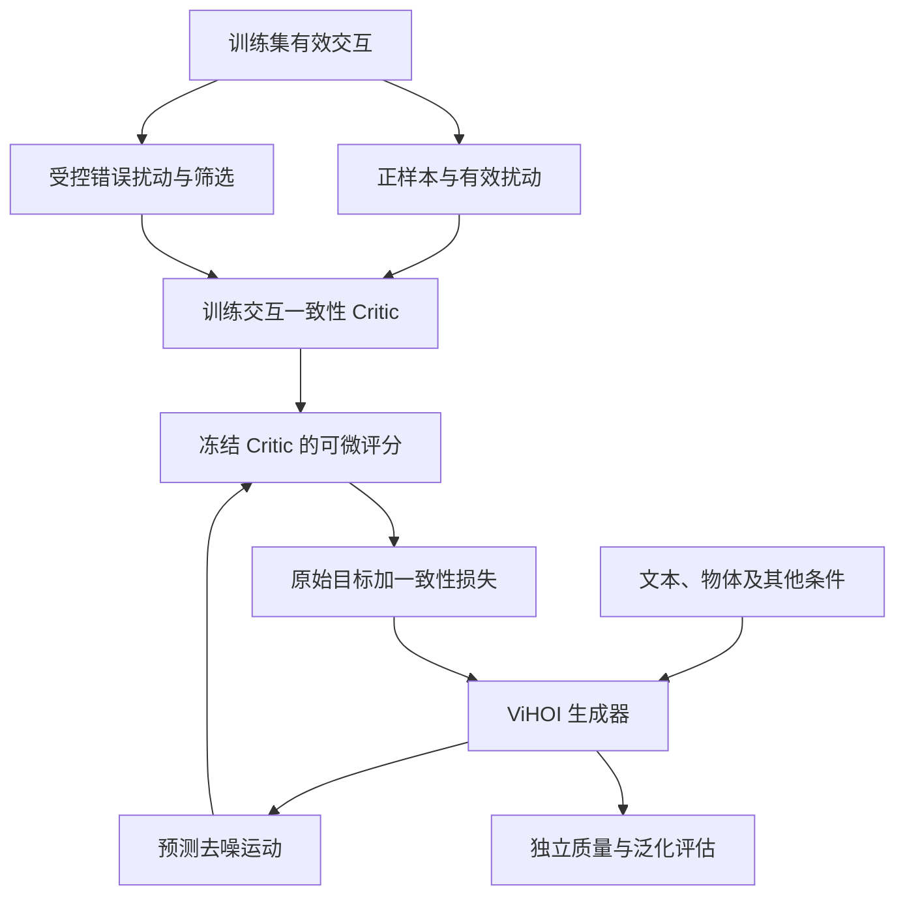

# CounterHOI

## 基于结构化错误轨迹监督的三维人–物交互生成

**Learning 3D Human–Object Interaction Generation from Structured Invalid Trajectories**

通过构造具有明确交互错误的三维运动轨迹，训练交互一致性评分模型（Interaction Consistency Critic），并将其接入已有生成器，研究能否改善生成质量、交互一致性与未见动作–物体组合上的表现。

> **项目定位：完整研究方案，用于 FYP，并为后续论文投稿积累实验。** 主路线为“结构化负样本 → Critic → 生成器一致性训练 → 独立评估”；候选重排序是先验验证及备用方案，不替代主路线。Difficulty-Aware Curriculum 为辅助实验。
>
> **当前进展说明：** 团队已报告取得 ViHOI 权重，并已推进原分工中的 A、B 工作。本文不将其具体代码、训练结果或集成状态自动标记为完成；后续以现有提交、配置、检查点与运行日志登记进度。已完成且验证有效的模块继续复用，不要求重新开发。

---

## 1. 项目目标

三维人–物交互（3D HOI）生成需要协调人体动作、物体运动和接触关系。生成结果可能局部平滑，却出现持续抓持阶段提前松手、必要接触缺失、接触与物体运动时序不一致等错误。

本项目研究：

> **在相同训练数据和生成骨干下，针对性的错误交互监督，能否比简单接触约束或通用随机扰动更有效地改善真实生成结果，并迁移到未见动作–物体组合？**

项目输入为文本、物体表示及基线实际需要的其他条件，输出为人体与物体的三维运动序列。额外的视觉先验、初始状态和轨迹条件必须依据实际 ViHOI 接口记录，不能将任务未经核实地描述为纯文本生成。

FYP 交付完整系统、可复现实验、演示和研究报告；论文是否具备投稿竞争力，由方法差异、实验收益、可靠性和相关工作核查决定，不预设结果或录用承诺。

## 2. 研究范围

| 项目 | 本项目安排 |
| --- | --- |
| 主基线 | ViHOI；复用已取得的检查点并核实版本、适配数据及使用条件 |
| 首个数据集 | OMOMO / 基线兼容的处理后数据，实际格式与标注需审计 |
| 核心模块 | 结构化负样本、Interaction Consistency Critic、生成器一致性训练 |
| 核心实验 | 真实生成错误、直接几何约束对照、负样本设计、组合泛化 |
| 辅助实验 | Difficulty-Aware Curriculum、候选重排序及候选数分析 |
| 可选扩展 | 第二数据集、第二生成骨干、更多未见物体 |
| 暂不纳入 | 新扩散骨干、VLM 重训练、多物体与关节物体、机器人部署、完整物理仿真控制 |

接触表示用于构造监督、提取特征和评价，不单独包装为主要创新。组合泛化是核心研究问题与评价设置，不因使用 unseen split 就自动构成独立创新。

## 3. 总体技术路线



先验证 Critic 是否能识别真实生成错误，再接入生成器训练；该顺序用于降低集成风险，不缩减最终研究范围。重排序实验复用已有候选，帮助判断评分器是否有用，但其收益不等于生成器学习收益。

## 4. Counterfactual Negative Interaction Generation

### 4.1 定义与构造原则

本文的“反事实负例”指受控修改运动后产生的错误交互，不主张严格因果识别。尽量只破坏目标交互因素，同时保留局部运动合理性、动作条件及其他关系。

必须修改真实姿态、位置或时序，再重新计算几何与接触。不能只篡改接触标签，或依靠严重跳变让模型轻易分类。

### 4.2 负样本类型

| 类型 | 构造思路 | 适用条件与边界 |
| --- | --- | --- |
| Premature Release | 在需要持续抓持的阶段提前打断接触，保留对应物体搬运运动 | 排除正常释放、投掷和允许接触中断的动作 |
| Object Motion Without Required Contact | 改变人–物相对位置或时序，使物体缺失必要支撑时仍按受控轨迹运动 | 排除惯性、滚动、自由落体、其他身体部位或环境支撑 |
| Spatial Contact Shift | 改变交互位置，破坏特定动作要求的接触关系 | 非原始抓持位置不一定错误，必须有几何或语义依据 |
| Wrong Body Part | 将接触转移到与当前任务不相容的身体部位 | 语义依赖强，作为有条件扩展；非手部接触本身不等于错误 |

优先复用团队已经完成且通过检查的类型。不能为了凑满类别，加入无法可靠判断的负例；前两种时序/支撑错误也可能重叠，应记录适用阶段与错误定义，避免当作独立贡献重复计数。

### 4.3 有效性筛选与人工检查

检查运动连续性、异常速度/加速度、距离、穿透、接触阶段和支撑状态。负例按“构造有效 / 构造无效 / 不确定”登记，不确定样本不进入确定监督。

分层抽查不同动作、对象、扰动类型和强度，记录接受率及排除原因。需要区分标签：`interaction_label` 表示交互是否有效，`construction_status` 表示构造是否通过检查，避免模糊的 `validity=true`。

每条衍生样本保留原始序列 ID、划分、扰动类型、参数、强度、随机种子、阶段、标签依据和检查结论。

### 4.4 有效扰动检查

增加“修改过但仍然有效”的正例或专项测试，避免 Critic 将编辑痕迹当成错误依据。可从同时变换人体、物体与相关条件的水平平移或竖直轴旋转开始；必须保持环境和文本约束成立。

这类全局变换只检验对应不变性，不能单独排除所有局部扰动捷径。后续可加入经人工确认仍有效的局部小幅变化，使正负样本在扰动幅度和运动平滑性上更接近。

## 5. Interaction Consistency Critic

### 5.1 输入、模型与输出

输入包含人体运动、物体运动、人–物相对几何、接触距离及可靠的文本/动作条件。优先采用已有冻结文本特征，不训练新的语言模型。

初版使用轻量时序编码器，如 TCN 或小型 Transformer，再接评分头。统一输出序列级 logit，分数越大表示模型认为交互越一致；未经校准不解释为真实物理正确概率。

### 5.2 训练目标

```text
L_critic = BCEWithLogitsLoss(C(x, condition), y)

y = 1：经检查的有效交互
y = 0：经检查的错误交互
```

先使用二分类目标；如果同源正负轨迹对可靠，可将排序损失作为后续消融，不与所有其他变化同时加入。

数据加载不向模型输入扰动类型、标签理由等会泄漏答案的元数据。正负样本采用一致的长度掩码、预处理和数据格式，防止 padding、来源或编码差异成为捷径。

### 5.3 必须验证的能力

- 独立原始序列上的有效/错误交互区分。
- 对未见扰动强度、可行时未见类型的迁移。
- 有效扰动正例上的稳健性。
- 最重要：由实际生成器产生的正确与错误交互。
- 与简单距离、接触和相对运动规则的比较。

若只在合成负例上表现好，对真实生成错误无效，应优先调整样本构造与表示，而不是直接扩大网络。

## 6. 主路线：Critic 接入生成器训练

先训练 Critic，再冻结其参数，将生成器预测的去噪运动解码到一致表示，用可微特征计算评分并优化生成器。

```text
L_total = L_baseline + λ · L_consistency

L_consistency = softplus(-C(predicted_clean_motion, condition))
```

这是候选目标，具体实现必须适配 ViHOI 的预测参数化，不能把扩散噪声预测直接当作真实运动。训练步数、λ、作用时间步范围等通过验证集确定。

集成验收：

1. Critic 权重冻结，但梯度可经过 Critic 和特征计算返回生成器。
2. 不在训练路径中误用 `no_grad()`、`detach()` 或不可微的离线特征。
3. 几何项采用可微距离等形式；硬接触阈值可以用于评价，但不能截断关键训练梯度。
4. 损失与梯度有限，坐标、尺度、掩码和运动解码正确。
5. 保留原始生成目标，并检查动作质量、文本符合度和多样性。
6. 最终效果使用独立指标和匿名检查验证，不以 Critic 分数上升作为成功证据。

冻结 Critic 仍可能被生成器利用评分漏洞，应检查异常静止、持续抓持、动作偏移等结果。必要时降低权重、限制适用阶段或改进评分器；修改后须重新冻结配置并评价。

## 7. 辅助与备用路线：候选重排序

在相同条件下生成固定 `K` 个候选，缓存后分别进行随机、规则和 Critic 选择。三种方法共享候选 ID、输入信息和生成预算，报告额外评分耗时。

候选数量可配置。随机选择使用固定种子或计算均匀选择期望；不同评分器复用同一候选池，无需重复生成。若全部候选均错误，重排序不保证产生正确结果，应分析候选覆盖情况。

重排序用于先验证 Critic 的实用性，也是生成器训练不稳定时可保留的完整交付。但若最终只有重排序结果，必须将结论限定为候选选择改善，并明确主训练路线的实际状态。

## 8. 数据划分与组合泛化

### 8.1 固定数据协议

在正式训练前冻结 train / validation / test。先按原始序列划分，再切窗口、生成扰动；同源窗口和衍生样本不能跨集合。

归一化统计量只使用训练集。规则阈值、负例强度、模型选择和课程参数只用训练/验证集确定。真实生成结果也分开发验证候选集与最终测试候选集，测试结果不反复用于改模型。

### 8.2 Unseen Action–Object Pair

合法未见组合满足：动作和物体类别分别在训练集中出现，但二者组合不出现。先统计真实动作–物体频次矩阵，再选择有足够样本支持的划分。

区分未见组合、未见物体实例和未见物体类别，不能混用术语。数据不足时缩小结论或增加数据，不制造无法支撑统计的测试集。

### 8.3 已有权重的数据暴露

取得 ViHOI 权重可以节省获取可用模型的成本，但不自动满足自定义组合划分。必须记录权重来源、训练数据范围、配置与校验信息。

若预训练权重已经见过保留组合，则不能将其称为严格未见组合实验。选择重新按划分训练公平基线，或明确改为“已知预训练暴露条件下的泛化分析”，并披露限制。所有方法使用相同的数据暴露与条件。

## 9. Difficulty-Aware Curriculum

课程训练作为辅助实验，不预设其优于随机混合。难度结合扰动幅度、持续时间与实际验证表现定义，不直接把物理、空间、时间类型固定等同于简单、中等、困难。

比较同一负样本池的 Random Mixing 与 Difficulty Curriculum，匹配训练步数、正负比例并尽可能匹配样本总曝光量。参数由验证集确定，不能以测试集表现动态调整课程。

若课程无收益，报告结果并保留基础方法，不强行将其作为贡献。

## 10. 实验与独立评价

### 10.1 核心实验矩阵

| 实验 | 对照设置 | 回答的问题 |
| --- | --- | --- |
| 原始基线 | 原始 ViHOI 检查点 | 原始性能参考 |
| 训练预算对照 | 基线继续训练相同步数，仅保留原目标 | 收益是否只是来自额外训练？ |
| 直接约束 | 同骨干加入直接接触/相对几何损失 | 为什么需要学习式 Critic？ |
| 完整方法 | 同骨干加入结构化负例训练的 Critic 目标 | 是否改善真实生成质量？ |
| 负样本设计 | 通用随机扰动 vs 结构化交互扰动 | 特定错误构造是否有价值？ |
| 重排序 | 同候选池随机、规则、Critic 选择 | 评分能力是否可用于候选选择？ |
| Critic 迁移 | 合成错误 vs 真实生成错误 | 是否学到了超越扰动痕迹的规律？ |
| 组合泛化 | Seen / Unseen Pair 分组比较 | 收益能否迁移到未见组合？ |
| 类型与课程 | 逐类移除；随机混合 vs 课程 | 哪些监督和训练策略有效？ |

核心训练对照匹配数据、初始化、训练预算、模型选择规则与采样配置。更多骨干或第二数据集属于后续扩展，不能挤占关键对照。重要结果尽量重复随机种子，报告实际数量与波动，单次结果明确标记。

### 10.2 指标与人工检查

| 维度 | 指标/检查 | 使用限制 |
| --- | --- | --- |
| 生成质量 | 核实后沿用适用的官方指标 | 相同预处理与评估器，检查其数据暴露 |
| 接触质量 | Contact Precision / Recall / F1 | 仅用于参考可对齐且定义成立的设置，不将唯一参考接触当作唯一正确答案 |
| 交互错误 | 提前释放率、必要接触中断率、缺乏支撑的运动比例 | 定义阶段、分母和合法例外 |
| Critic | AUROC、Balanced Accuracy、混淆矩阵 | 合成与真实数据分别统计，单类子集不计算 AUROC |
| 语义与运动 | 文本符合度、运动平滑性、多样性及失败案例 | 防止靠僵硬或持续抓持刷高接触指标 |
| 效率 | 训练/生成/评分耗时、峰值显存 | 缓存与在线计算分开记录 |

几何推导接触称为估计或伪标签。记录阈值、单位、坐标与帧率，并做必要敏感性检查。

真实结果人工评价隐藏方法名称和 Critic 分数，记录合理、错误和不确定及判定理由；安排两名成员复核一个子集，报告分歧处理。统计单位为独立条件或原始序列，不把相邻帧当独立样本。

## 11. 三人工作分配

本节按工作包、接口和验收分工，不按周排期。A、B、C 是职责编号，不是完成状态。每个人先将已有成果登记为“已完成并验收 / 待验收 / 进行中 / 未开始 / 阻塞”，附 commit、配置、日志或结果路径；已有可用模块直接复用。

下列路径为建议交付位置，可映射到现有代码，不要求为了目录一致重写实现。

### 11.1 分工总览

| 负责人 | 主责 | 最终需要回答的问题 | 不重复承担的工作 |
| --- | --- | --- | --- |
| A：生成器与集成 | ViHOI、生成器训练、损失接入、候选生成与系统集成 | Critic 是否真正改善生成，而非仅改变评分？ | 不重新开发 B 的 Critic，不自行另定 C 的测试协议 |
| B：负样本与 Critic | 运动数据适配、负样本、训练特征、Critic、相关消融 | 模型是否从可信负例中学到了可迁移的交互知识？ | 不同时另做一套最终规则对照，不单方面修改划分 |
| C：评估与泛化 | 划分、独立规则、指标、真实错误评价、泛化与统计 | 比较是否公平，改善是否真实且可重复？ | 不承担所有模型训练，不独自承担全部报告 |

A 负责最终系统集成，B 负责训练数据和评分模型，C 负责实验协议与结果汇总。共享模块只设一个维护负责人，其他成员通过接口使用。

### 11.2 A — Generation & Integration Lead

**职责目标：在现有 ViHOI 基础上完成生成、Critic 接入和训练对照，并形成可复现系统。**

#### A1. 接收已有基线成果并确认可用范围

具体工作：

- 整理已取得权重的来源、文件校验、对应代码 commit、训练配置和已知数据范围。
- 用现有环境复现一条成功推理记录，确认权重能生成可视化运动，而不仅是能够加载。
- 记录实际输入条件：文本、物体几何、初始人体/物体状态、视觉先验或其他轨迹条件。
- 测试官方评价入口与训练入口是否可用，区分“推理成功”和“完整复现论文指标”。
- 将缺失资源、硬编码路径、依赖版本和已知错误写入复现记录。

交付：`reports/baseline_reproduction.md`、基线配置、成功运行命令、少量运动结果与预览。

验收：其他成员按记录可加载相同检查点并生成结果；未验证项清楚标记，不重复要求已通过的复现工作。

#### A2. 封装生成器接口并建立候选缓存

具体工作：

- 将基线输出转换为三人约定的数据格式，确认坐标、单位、旋转和有效帧掩码。
- 实现固定种子的批量生成，支持可配置的候选数量 K。
- 缓存原始候选及 `condition_id / candidate_id / seed / checkpoint_id / sampling_config`。
- 按 C 的开发、验证和测试清单生成对应候选，不混用集合。
- 先提供小批真实生成结果给 B/C 检查，不等待整个实验批次完成。

交付：`adapters/vihoi_adapter.py`、`scripts/generate_candidates.py`、候选 manifest 与缓存读取说明。

验收：相同配置与种子具有可核查的复现性；所有选择方法读取同一候选池；候选与原始条件能一一追溯。

#### A3. 接入 Critic 一致性训练

具体工作：

- 找到 ViHOI 的预测参数化与损失入口，将预测转换成正确的去噪运动表示。
- 接收 B 的 Critic 和可微特征接口，冻结 Critic 参数并保留输入梯度。
- 实现一致性损失、权重配置、适用时间步/阶段掩码和日志。
- 检查 `detach`、`no_grad`、归一化、旋转解码、padding 和非有限值。
- 做短训练检查，确认梯度到达生成器，Critic 参数没有被更新。
- 检查 Critic 分数提升时是否出现静止、持续抓持、动作失真等评分漏洞。

交付：`training/consistency_loss.py`、生成器训练入口、集成配置、`reports/generator_integration.md`。

验收：损失与梯度有限、参数冻结正确、生成器确实获得梯度；短训练可运行。最终“有效”必须由 C 的独立结果判定，不能仅看训练 loss。

#### A4. 实现并运行生成器侧公平对照

具体工作：

- 保存原始检查点结果。
- 运行等预算继续训练：相同初始化与训练步数，仅保留原目标。
- 实现直接接触/相对几何损失对照；C 审核评价与对照定义，A 编写可微训练实现。
- 运行加入结构化负例 Critic 的完整方法。
- 接收 B 提供的不同 Critic 检查点，执行确有必要的生成器侧负样本消融。
- 若严格组合划分要求重训，由 A 执行生成器重训；C 确认划分，B 提供匹配该划分的 Critic。

交付：各方法配置、训练日志、检查点索引、生成结果及 `reports/generator_experiments.md`。

验收：初始化、数据、步数、模型选择与采样条件可比较；额外训练量单独交代；未完成的实验不得填入结果表。

#### A5. 重排序、系统演示与写作

具体工作：

- 实现统一 selector，调用 C 的规则评分与 B 的 Critic；不在此处复制两者模型逻辑。
- 保存选中候选 ID 与全部分数，支持随机、规则和 Critic 选择。
- 集成评价命令、结果导出和 C 提供的渲染素材，形成可重放 Demo。
- 记录生成耗时、评分耗时和峰值显存，提供运行说明。
- 撰写基线、生成器集成、训练设置与系统实现章节。

交付：`selection/selector.py`、演示入口、运行文档和系统实现稿。

验收：从已有候选缓存能够重现选择结果；展示明确区分生成器训练与候选筛选；A 负责最终集成，不必另做复杂网页。

### 11.3 B — Counterfactual & Critic Lead

**职责目标：建立可信的错误交互监督，交付可以独立评分、也可以参与生成器训练的 Critic。**

#### B1. 审计数据并实现训练侧特征

具体工作：

- 确认人体表示、关节顺序、物体局部几何、世界位姿、帧率、单位和归一化。
- 明确已有接触标签的来源；几何计算所得接触不能直接称为真实标签。
- 在 C 的冻结划分下建立数据加载器，保存原始序列来源和有效帧掩码。
- 实现人–物相对位置、距离、速度等训练特征，并可视化抽查。
- 与 A 对齐运动解码，与 C 对齐数据契约；共享基础几何函数，但不共享最终质量标签判定。

交付：数据适配/加载器、`features/interaction_features.py`、`reports/data_audit.md`、小批样本预览。

验收：随机抽取样本时运动与物体对齐；单位和坐标正确；同一样本经保存/加载后含义一致。

#### B2. 维护结构化错误样本构造

具体工作：

- 盘点已有扰动，优先保留经过验证的类型。
- 为每种扰动明确适用动作、接触阶段、参数范围、目标错误和合法例外。
- 实现提前释放、必要接触缺失和可可靠判断的空间偏移；Wrong Body Part 仅在语义依据充分时加入。
- 修改实际轨迹并重新计算特征，记录是否引入严重跳变或额外错误。
- 输出接受/排除记录和原因，组织按类型与强度分层的人工抽查；C 复核一个子集。
- 使用 `source_id` 约束衍生样本划分，不能在生成后随机打散造成泄漏。

交付：`counterfactual/`、扰动配置、样本 manifest、`reports/counterfactual_quality.md`。

验收：相同输入与 seed 可复现；负例有明确错误依据；不确定样本被排除或单列；类型间重叠已说明。

#### B3. 有效扰动与捷径检查

具体工作：

- 加入经验证仍有效的变换正例，保留变换参数与条件一致性记录。
- 检查正负例是否存在长度、padding、来源、速度突变或存储格式差异。
- 不把扰动类别、人工判定理由或标签元数据送入 Critic 输入。
- 比较原始正例、有效扰动正例、错误负例的评分分布，定位系统性误判。
- 在必要且可可靠验证时，加入小幅有效局部扰动，避免只有全局变换检查。

交付：有效扰动样本/专项测试、`reports/critic_shortcut_checks.md`。

验收：对照能够揭示具体捷径风险；检查失败时记录并修正，不能以整体分类准确率掩盖。

#### B4. Critic 实现、训练与模型交接

具体工作：

- 选择一个轻量时序架构作为初版，实现二分类目标、掩码和验证模型选择。
- 固定输入特征、正负比例与采样方式，记录训练步数和随机种子。
- 先交付可工作的 Critic v0，再扩展其他扰动与模型改进。
- 将推理 `score()` 与可微 `forward()` 分开，实现独立加载和批量评分。
- 检查从 motion 到 logit 的可微路径；与 A 联合检查生成器训练所需的输入梯度。
- 将模型配置、特征配置、归一化统计、检查点和已知适用范围一起交付，不只发送权重文件。

交付：`models/interaction_critic.py`、`training/train_critic.py`、模型包、`reports/critic_model_card.md`。

验收：A 可在独立进程加载并调用；输入输出形状、分数方向、掩码和错误处理清楚；C 可用同一模型包运行独立评价。

#### B5. Critic 消融、迁移改进与写作

具体工作：

- 训练通用随机扰动与结构化负例两类 Critic，控制架构、数据来源和训练预算。
- 做必要的负样本类型移除、未见强度和有效扰动检查。
- 课程实验使用同一负样本池，与随机混合比较，不暗中增加训练量。
- 依据 C 的开发/验证集结果改进模型；最终测试数据不能被回填为训练样本。
- 提交所有 Critic 变体与配置，由 A 决定与协议一致的生成器实验运行，由 C 统一统计。
- 撰写负样本、Critic、训练策略与对应消融章节。

交付：变体检查点索引、训练记录和方法章节；未执行的辅助实验明确标记。

验收：能区分“判别器自身变好”与“生成结果变好”；两种结论使用对应实验支撑。

### 11.4 C — Evaluation & Generalization Lead

**职责目标：建立可信数据划分和独立评估，判断各项方法改动究竟带来了什么。**

#### C1. 划分、数据覆盖与泄漏审计

具体工作：

- 汇总已有训练清单和权重数据范围，先检查已完成工作能支持哪些结论。
- 冻结原始序列级 train / validation / test 及版本，检查同源窗口、衍生样本与人物重叠是否符合协议。
- 统计动作–物体频次矩阵，区分物体类别、实例和动作标签。
- 为组合泛化选择样本支持充分的保留组合，确认单独动作与物体类别均在训练中出现。
- 检查 ViHOI 权重、Critic、归一化和评估器的数据暴露；必要时提出重训范围，由 A/B 执行。
- 如果组合划分不可用，给出数据证据与可报告范围，不为凑实验勉强划分。

交付：`splits/`、`datasets/compositional_split.py`、`reports/split_audit.md`、动作–物体统计表。

验收：清单可追溯；泄漏检查可运行；严格 unseen 与有预训练暴露的实验被明确区分。

#### C2. 独立规则评分与评价指标

具体工作：

- 跑通适用的官方指标，记录版本、依赖和参考数据要求。
- 实现规则评分器，按动作阶段和可用信息判断接触/相对运动，不使用测试真值作为推理输入。
- 在验证集固定阈值与规则权重，提供给 A 调用；B 不再维护另一套最终规则对照。
- 定义提前释放、接触中断和其他错误指标的适用样本、分母、例外及不确定样本处理。
- 检查 Contact F1 是否具有合理参考与时间对齐；不成立时不强报该指标。
- 定义直接几何损失对照要检验的问题，与 A 确认实现，避免把规则分类与生成训练混为一谈。

交付：`evaluation/rule_based_scorer.py`、独立指标、`configs/evaluation.yaml`、`reports/evaluation_protocol.md`。

验收：规则可在测试结果产生前冻结；最终评价不使用 B 的 Critic 自评分；指标定义可被其他人复核。

#### C3. 真实生成错误集与匿名检查

具体工作：

- 接收 A 的候选缓存，区分开发/验证与最终测试条件。
- 定义人工检查说明，记录有效、错误、不确定以及错误类型和依据。
- 隐藏方法、排序分数及相关提示，避免检查者被模型结论影响。
- 组织两名成员独立检查一个子集，记录一致率、分歧与复核；C 负责流程，标注工作由全员分担。
- 固定样本选择规则，保留难例、无改善及所有候选都失败的情况。

交付：匿名检查清单、标注表、复核记录、真实错误数据说明。

验收：结论可追溯至独立样本；未挑选只对本方法有利的案例；测试标注不用于 B 的模型调参。

#### C4. 实验管理、统计与泛化评估

具体工作：

- 在主实验运行前建立方法矩阵，指定每组初始化、数据、预算、种子和模型选择依据。
- 接收 A/B 的原始输出，核查是否缺少等预算继续训练或直接约束对照。
- 分别统计 Critic 判别、重排序选择质量、生成器训练收益，避免混入一张含义不清的表。
- 计算 Seen / Unseen Pair 分组结果，报告样本量、实际种子数和波动。
- 以条件或原始序列为统计单位进行必要的配对比较或重采样区间，避免把相邻帧当独立样本。
- 保留逐样本结果与无收益实验，维护统一实验台账。

交付：`evaluation/compositional_eval.py`、`evaluation/summarize_results.py`、结果 CSV、实验台账和主表。

验收：表格可由保存的输出重新生成；每个数字能回溯到配置与运行；核心结论明确区分事实与解释。

#### C5. 可视化、相关工作与写作

具体工作：

- 提供并列对比渲染、接触点与时间线，统一相机、速度、条件和显示尺度。
- 按预先确定的规则选取成功、失败、未改善和候选覆盖不足的案例。
- 维护相关工作表，记录任务、监督来源、是否使用错误轨迹、训练方法、评价设置及来源链接。
- 对新的相关工作先核查方法差异，再提出对照或表述调整，不因名称相近就改变架构。
- 撰写实验设置、结果、泛化、相关工作与限制；将素材交给 A 集成 Demo。

交付：图表、视频素材、`reports/related_work.md`、评价与分析章节。

验收：可视化不掩盖失败，指标和图表匹配；新颖性判断有来源与实验依据。

### 11.5 交接清单

| 交接 | 必须包含 | 接收方检查 |
| --- | --- | --- |
| C → A/B：划分与协议 | 序列清单、版本、排除规则、训练/验证/测试定义 | 现有训练是否兼容；有冲突先记录，不静默混用 |
| A → B/C：生成结果 | 原始运动、条件、候选 ID、seed、检查点和采样配置 | 表示可读、坐标正确、来源齐全 |
| B → A：Critic 模型包 | 权重、架构配置、特征与归一化、输入形状、score/forward、示例 | 独立加载、分数方向、掩码和梯度路径 |
| B → C：负样本与变体 | 来源、类型、强度、标签依据、质量报告、模型版本 | 划分无泄漏，人工检查可追溯 |
| C → A：规则评分器 | 配置、阈值来源、统一评分接口 | 使用同候选池和同等可用信息 |
| A/B → C：实验运行 | 原始输出、配置、日志、seed、运行状态和检查点 | 方法预算可比，不能只交最终均值 |
| C → 全员：评价结果 | 主表、逐样本结果、统计说明、失败案例 | 三人共同检查结论是否超出证据 |

### 11.6 推荐完成顺序与工作边界

1. 三人盘点已有成果，C 明确哪些划分和结论可用，A/B 补必要元数据。
2. A 提供少量真实候选，B 交付最早可用的 Critic，C 提供规则与独立评价。
3. 完成同候选池的比较，检查 Critic 是否只识别合成痕迹。
4. A/B 联合接入可微一致性训练，C 审核公平对照。
5. A 运行生成器实验，B 运行 Critic 消融，C 统计独立结果和泛化。
6. 核心结果清楚后再投入课程、更多类型或第二数据集；全员整合报告和演示。

这不是按周排期，也不要求重做已经通过的环节。阻塞需写明缺少的输入、负责解决的人及可继续进行的工作。模型未超过规则属于研究结果，不等于代码未完成；“实现通过”与“假设得到支持”分别登记。

### 11.7 各自最终提交包与共同写作

- **A 提交包：** 基线复现、生成/训练配置、集成代码、生成器对照、候选/检查点索引、系统运行说明。
- **B 提交包：** 数据审计、负样本工具与质量记录、Critic 模型包、训练与消融记录、特征说明。
- **C 提交包：** 划分协议、独立规则和指标、标注复核、原始结果汇总、统计图表、泛化与相关工作分析。
- **共同提交：** FYP 报告、答辩材料、Demo 和论文初稿素材。各人先写自己负责部分，摘要、主张、限制和结论共同审查。

每个任务记录任务 ID、负责人、状态、依赖、commit、运行命令、交付位置和验收证据。没有证据的旧成果标为“待验收”，不默认完成，也不直接要求推倒重做。

## 12. 接口与目录设计

### 12.1 数据契约

统一样本包含 `schema_version`、`source_id`、`sample_id`、`split`、`condition`、人体运动、物体运动、有效帧掩码与元数据。版本化配置明确关节顺序、旋转表示、坐标系、单位、帧率和归一化统计。

候选额外保存 `condition_id`、`candidate_id`、`seed`、生成器 commit、检查点标识和采样配置。原始候选不可被选择结果覆盖。

### 12.2 建议接口

以下为待与现有实现对齐的接口，不表示仓库已经提供这些 API。

```python
candidates = generator.generate(condition, num_candidates=K, seeds=seeds)
result = corruption.apply(sample, severity=severity, seed=seed)

# FYP 演示、批量评价：允许无梯度推理
scores = critic.score(candidates, condition)

# 生成器训练：必须保持梯度路径
logits = critic.forward(predicted_motion, condition, valid_mask)

selected_ids = selector.select(candidate_ids, scores)
metrics = evaluator.evaluate(outputs, annotations, protocol)
```

接口区分可微训练路径与离线评分路径。基础几何函数可以共享，但构造标签、规则对照和最终质量判定保持清楚边界。

### 12.3 建议目录

```text
3DHOI/
├── README.md
├── configs/                 # 数据、表示、模型、训练和评价配置
├── adapters/                # ViHOI 及未来其他骨干的适配器
├── datasets/                # 数据审计、加载和组合划分
├── features/                # 几何特征与可微特征路径
├── counterfactual/          # 扰动、筛选、有效正例与难度
├── models/                  # Interaction Consistency Critic
├── training/                # Critic 训练、生成器一致性目标、课程采样
├── selection/               # 候选缓存读取与重排序
├── evaluation/              # 规则评分、独立指标与统计
├── visualization/           # 运动渲染、接触时间线、对比视频
├── scripts/                 # 可复现运行入口
├── splits/                  # 版本化划分清单
├── tests/                   # 泄漏、坐标、掩码、梯度等关键检查
└── reports/                 # 实际进度、复现、质量审计、实验与失败分析
```

已有文件不必为匹配此目录强行重写；保证职责、接口和运行入口清楚即可。原始数据、大型缓存、检查点和视频通过配置定位，默认不提交到 Git。

## 13. 资源与实验记录

已有权重优先用于推理复现和候选生成。小 Critic 与开发可先用现有 16GB GPU；生成器训练优先实测 24GB GPU 配置，是否需要更大显存依据峰值显存和吞吐决定，不预设能跑满官方 batch。

预先缓存 VLM 特征与候选，避免反复生成。参考图像及其来源需要记录，正式测试不能用目标真实运动渲染图替代推理条件，除非明确作为使用额外真值信息的诊断实验。

分别测量预处理、生成、Critic 训练、生成器训练、评分和渲染开销。训练耗时依据实测每步时间及目标步数估算，不把取得权重等同于不再需要公平基线训练。

每个实验保存 commit、数据/划分版本、完整配置、随机种子、GPU、步数、耗时、显存、检查点、评价命令和结果路径。检查点记录来源及校验信息。禁止写入未实际运行的性能数字。

Git 分支建议：A `baseline-generator`，B `counterfactual-critic`，C `evaluation-generalization`。每个可验收任务通过小 PR 集成，附实际命令、结果和已知问题；不得将密钥或受限数据提交到仓库。

## 14. 验收与最终交付

- [ ] 已有权重、代码、数据和 A/B 交付已盘点，并标记实际完成状态。
- [ ] 基线推理、评价、可视化和训练入口可复现。
- [ ] 序列级划分及预训练暴露检查完成。
- [ ] 有效负样本、有效扰动检查及元数据完整。
- [ ] Critic 在独立合成样本和真实生成结果上均有评价。
- [ ] 生成器一致性训练完成梯度、稳定性和质量检查。
- [ ] 等预算继续训练、直接几何约束及核心负样本对照完成。
- [ ] 组合泛化有可靠协议与结果；若数据不支持，明确记录证据和结论限制。
- [ ] 重排序实验区分选择收益与生成器训练收益。
- [ ] 课程等辅助实验的执行状态和结果如实记录。
- [ ] 提供可复现代码、配置、检查点（许可允许时）、结果表、视频、FYP 报告及论文初稿素材。

Demo 使用匹配条件展示基线与完整方法，叠加接触点或时间线，并包含失败和未改善案例。若展示重排序，应标明候选数与选择方法。

FYP 完成以系统、方法、评价和分析为依据，不以必须取得正收益或论文录用为前提。若主训练路线未成功，应明确未完成项与原因，保留可运行的重排序系统及完整实验分析。

## 15. 相关工作与论文扩展

不能宣称首次将 counterfactual learning 用于 HOI，也不能仅因“负样本＋Critic＋课程”的组合不同就判断创新成立。核心价值需要通过真实错误迁移、直接约束对照和泛化结果建立。

已核实过的参考入口如下；实施与投稿前继续检查代码、数据、版本和许可状态：

- [ViHOI 官方仓库](https://github.com/MPI-Lab/ViHOI) 与 [论文](https://arxiv.org/abs/2603.24383)：主基线及视觉先验生成设置。
- [ScriptHOI](https://arxiv.org/abs/2605.05057)：HOI detection 中的反事实脚本监督，限制宽泛的首次性表述。
- [PRISM](https://arxiv.org/abs/2609.38172)：反事实视频用于扩展交互数据和机器人学习，与无效轨迹负例用途不同。
- [COSMI](https://arxiv.org/abs/2610.03252)：多物体组合生成与未见交互组合，提醒收紧组合泛化创新表述。
- [DIGHT](https://arxiv.org/abs/2610.10322)：物理偏好驱动的交互生成后训练，需讨论学习策略差异。
- [PAMI](https://arxiv.org/abs/2609.38466)、[TRACE](https://arxiv.org/abs/2609.32551)：接触与人–物耦合建模相关工作；根据任务一致性、资源和代码可用性决定是否增加对照。

跨任务工作作为相关工作讨论，不直接混入同一数值比较表。第二数据集、第二骨干、更广的错误类型与更充分重复实验，均可复用统一适配器、扰动插件、评分接口和独立评价协议继续扩展。

**项目最终要回答的是：结构化错误轨迹监督是否提供了简单接触规则之外的信息，并能将这种信息转化为更可靠的三维交互生成。**
